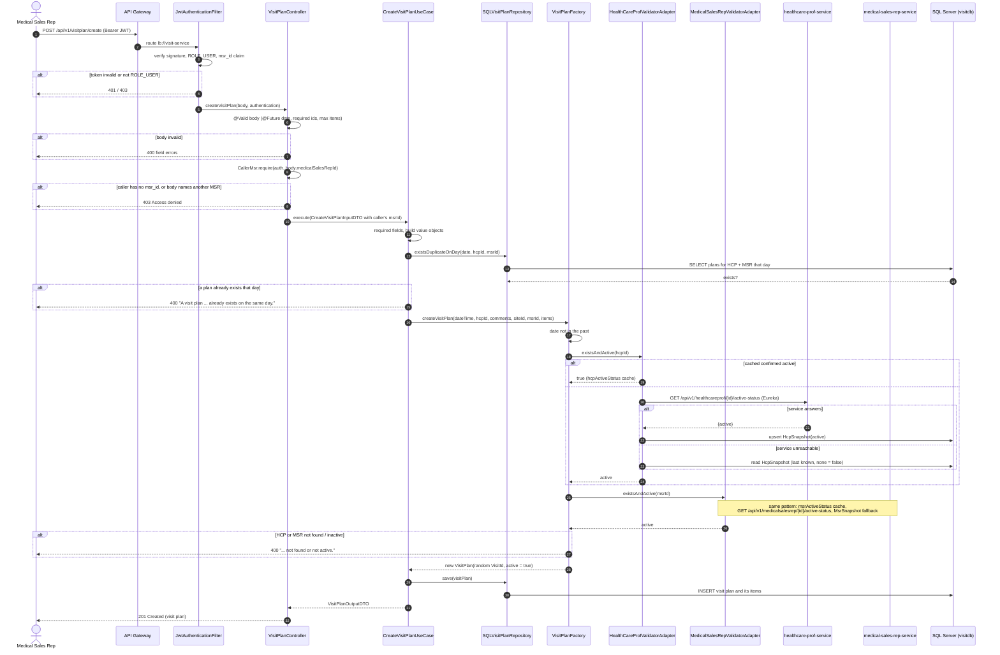

# Create VisitPlan — sequence diagram

`POST /api/v1/visitplan/create` in visit-service: a Medical Sales Rep plans a visit to a Healthcare Professional.
Request body: `visitDateTime` (future, `yyyy-MM-dd'T'HH:mm:ss`), `healthCareProfId`, `visitSiteId`, optional
`visitComments`, optional `medicalSalesRepId` (must be the caller's own) and optional `items` (products to bring).

## Notes

- **Ownership.** A visit plan always belongs to the caller's own MSR, taken from the token's `msr_id`. A body naming
  another MSR is refused, never silently reassigned (OWASP A01).
- **Anti-corruption layer.** visit-service only asks HCP and MSR for an `active` boolean, with no personal data and
  no forwarded user JWT. Only a confirmed `true` is cached, so a transient failure is never cached as "inactive".
- **Resilience.** When HCP or MSR cannot be reached, the local snapshot's last-known flag decides; with no snapshot
  the check fails closed (`false` → `400`).
- **Errors.** Domain and validation errors answer `400` with their message (`GlobalExceptionHandler`); authorization
  errors answer `403 Access denied`.
- **No events.** Creating a plan writes one row through JPA and publishes nothing to the broker.

Code: [VisitPlanController](../../visit-service/visit-application/src/main/java/com/das/visit/application/VisitPlanController.java) ·
[CreateVisitPlanUseCase](../../visit-service/visit-domain/src/main/java/com/das/cleanddd/domain/visit/usecases/services/CreateVisitPlanUseCase.java) ·
[VisitPlanFactory](../../visit-service/visit-domain/src/main/java/com/das/cleanddd/domain/visit/entities/VisitPlanFactory.java) ·
[HealthCareProfValidatorAdapter](../../visit-service/visit-infra/src/main/java/com/das/infra/service/visit/HealthCareProfValidatorAdapter.java)
