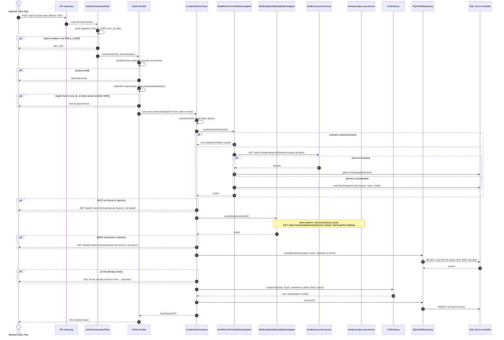

# Create Visit — sequence diagram

`POST /api/v1/visit/create` in visit-service: a Medical Sales Rep records a visit made to a Healthcare Professional.
Request body: `visitDate` (`yyyy-MM-dd`), `healthCareProfId`, `visitSiteId`, optional `visitComments`, optional
`medicalSalesRepId` (must be the caller's own) and optional `items` (products handed out).

## Notes

- **Visit vs. visit plan.** A visit records what happened, so its date is a day (`yyyy-MM-dd`, stored at 00:00) and
  may be in the past. A [visit plan](create-visit-plan.md) is a future appointment with a time.
- **Order of checks.** Here the use case checks the HCP and MSR first and the duplicate second. Create VisitPlan
  does the opposite, and runs the HCP/MSR checks inside `VisitPlanFactory`.
- **One visit per key.** HCP + MSR + date identifies a visit.
- **Ownership, ACL and resilience** work as for visit plans: the MSR comes from the token's `msr_id`, the HCP and MSR
  services only answer an `active` boolean, only a confirmed `true` is cached, and the local snapshot decides when
  a service is unreachable (no snapshot → refused).
- **Errors.** Domain and validation errors answer `400` with their message; authorization errors `403 Access denied`.
- **No events.** Creating a visit writes through JPA and publishes nothing to the broker.

Code: [VisitController](../../visit-service/visit-application/src/main/java/com/das/visit/application/VisitController.java) ·
[CreateVisitUseCase](../../visit-service/visit-domain/src/main/java/com/das/cleanddd/domain/visit/usecases/services/CreateVisitUseCase.java) ·
[VisitFactory](../../visit-service/visit-domain/src/main/java/com/das/cleanddd/domain/visit/entities/VisitFactory.java) ·
[SQLVisitRepository](../../visit-service/visit-infra/src/main/java/com/das/infra/service/visit/SQLVisitRepository.java)
