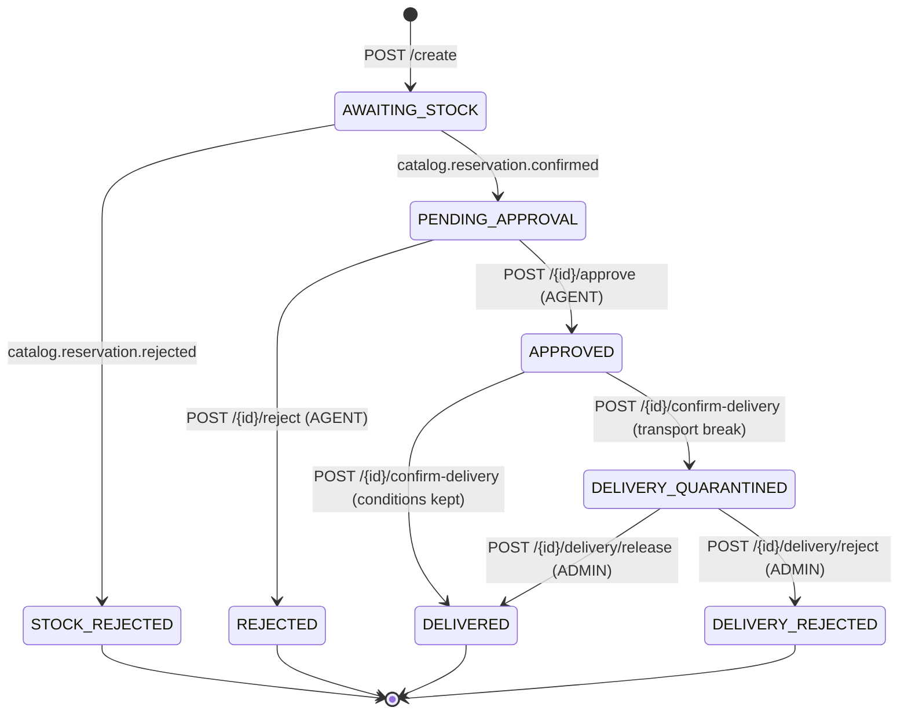
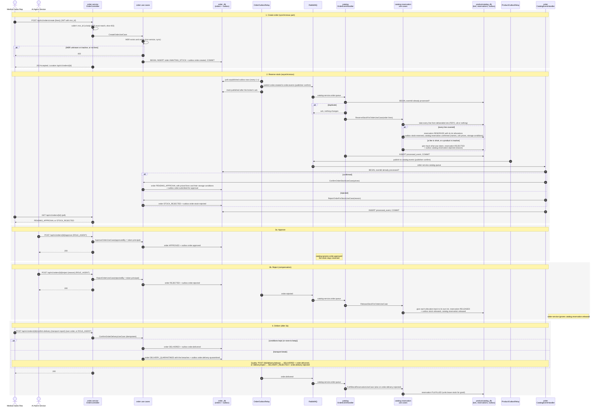

# Order stock saga — sequence diagram

A Medical Sales Rep orders products from the Pharma Lab. order-service accepts the order at once; product-catalog-service
reserves the stock asynchronously over RabbitMQ; the AI Agent Service approves or rejects; rejecting gives the stock
back (the compensating step); delivery fulfils the reservation.

Both services use a **transactional outbox**: a state change and the events it raises commit in one database
transaction, and a relay publishes the outbox rows to the broker afterwards. Each consumer records the `eventId` it
processed, so a redelivered message changes nothing.

## Order status

## Sequence

## Notes

- **Why a saga.** Orders and stock live in different services and databases, so there is no shared transaction. Each
  step commits locally and announces itself with an event; a rejection is undone by a compensating step (releasing
  the stock), not by a rollback.
- **Exchanges and queues.** order-service publishes to the `order.events` topic exchange; product-catalog-service
  consumes it on `catalog-service.order.queue` (binding `order.#`) and publishes to `catalog.events`, which
  order-service consumes on `order-service.catalog.queue` (binding `catalog.#`). Both are quorum queues with a
  dead-letter queue. Each side ignores event types it does not act on.
- **At least once, applied once.** The relays mark a row published only after the broker confirms it, so an event can
  be sent twice but never lost. Consumers skip an `eventId` already in `processed_event`, and the use cases ignore an
  order or reservation that has already moved on.
- **Failures.** A message that cannot be parsed is rejected straight to the dead-letter queue. One that fails to apply
  (e.g. unknown order) is retried, then dead-lettered for a person to inspect.
- **Stock is all or nothing.** A reservation takes every line or none, from lots chosen first expiry, first out,
  skipping quarantined, expired and short-dated lots (see [Stock lots and GS1](../../README.md#stock-lots-and-gs1)).
  The lots used are stored with the reservation, so a release returns units to the same lots and a recall can find
  the order.
- **Who may do what.** Only a Medical Sales Rep (token `msr_id`) places orders, always for themselves. Only the AI
  Agent Service (`ROLE_AGENT`) approves or rejects, and the approver is the token's principal, never the body.
  Delivery is confirmed by the order's own MSR or the agent.
- **Transport conditions (GDP).** Each confirmed line carries the product's storage conditions. Confirming delivery
  of an order with such lines needs the receiver's transport report; a break quarantines the delivery until Quality
  releases or rejects it. A rejected delivery still fulfils the reservation: the units left stock either way.
- **Timing.** The MSR sees `AWAITING_STOCK` in the `202` response and polls `GET /api/v1/orders/{id}` until the
  catalog's answer arrives, usually within a couple of relay intervals.

Code: [CreateOrderUseCase](../../order-service/order-domain/src/main/java/com/das/cleanddd/domain/order/usecases/services/CreateOrderUseCase.java) ·
[OrderOutboxRelay](../../order-service/order-infra/src/main/java/com/das/infra/service/order/outbox/OrderOutboxRelay.java) ·
[catalog OrderEventHandler](../../product-catalog-service/catalog-infra/src/main/java/com/das/infra/service/catalog/events/OrderEventHandler.java) ·
[ReserveStockForOrderUseCase](../../product-catalog-service/catalog-domain/src/main/java/com/das/cleanddd/domain/catalog/reservation/usecases/ReserveStockForOrderUseCase.java) ·
[order CatalogEventHandler](../../order-service/order-infra/src/main/java/com/das/infra/service/order/events/CatalogEventHandler.java)
